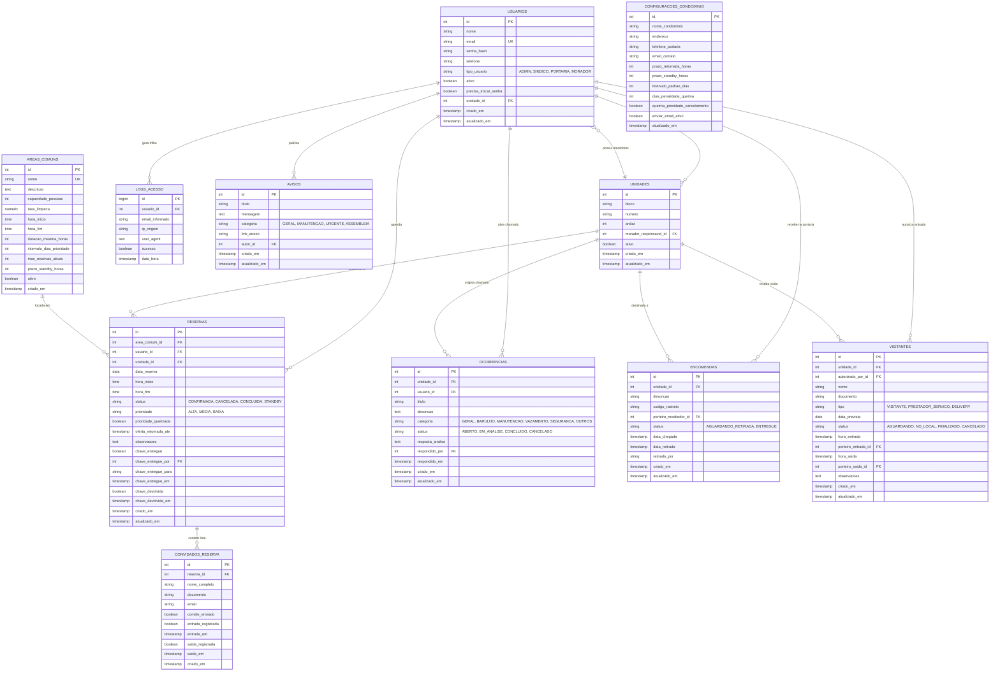

# 🗄️ Etapa 7: Projeto de Banco de Dados Completo (PIM IV)

> **Curso:** Curso Superior de Tecnologia em Análise e Desenvolvimento de Sistemas (UNIP)  
> **Disciplina:** Projeto Integrado Multidisciplinar IV (PIM IV)  
> **Sistema:** SGC — Sistema de Gestão de Condomínio  
> **Motor de Banco de Dados:** PostgreSQL 15+  
> **Script Consolidado:** [`schema_completo_pim_iv.sql`](schema_completo_pim_iv.sql)  
> **Pontuação da Etapa no Manual:** 1,0 ponto

---

## 📌 1. Visão Geral e Justificativa Arquitetural

Conforme preconizado no Manual do PIM IV, o banco de dados deve ser modelado com integridade referencial estrita, garantindo que regras de negócio críticas (como bloqueio de conflitos de reserva, auditoria de logins e rastreamento de entregas) sejam garantidas tanto na camada de aplicação (FastAPI / SQLAlchemy) quanto na camada de persistência nativa (PostgreSQL via Triggers e Procedures).

O banco de dados é composto por **11 entidades normalizadas (3FN)**, contemplando todo o ciclo operacional do condomínio: portaria, governança pelo síndico, autosserviço dos moradores e segurança da informação.

---

## 📊 2. Modelo Entidade-Relacionamento (MER / DER)



---

## 📑 3. Dicionário de Dados Resumido

| Tabela | Finalidade Principal | Integridade / Regras |
| :--- | :--- | :--- |
| **`usuarios`** | Autenticação, controle de perfis (RBAC) e dados cadastrais. | `email` único, hash bcrypt, enum de perfis. |
| **`unidades`** | Cadastro de apartamentos, blocos e morador titular. | Chave composta única `(bloco, numero)`. |
| **`logs_acesso`** | Auditoria e monitoramento de login (OWASP Top 10). | Registro imutável de IP, agente e sucesso. |
| **`areas_comuns`** | Parâmetros e limites dos espaços comunitários. | Capacidade > 0, taxa >= 0, horários definidos. |
| **`reservas`** | Agendamento e custódia de áreas de lazer e chaves. | Bloqueio de duplicidade via Trigger. |
| **`convidados_reserva`** | Lista de convidados para controle de portaria em eventos. | Exclusão em cascata com a reserva. |
| **`encomendas`** | Rastreio e baixa de encomendas entregues na guarita. | Trigger de preenchimento automático de retirada. |
| **`avisos`** | Mural de comunicados oficiais e convocações. | Categorização e suporte a links externos (Meet/Zoom). |
| **`ocorrencias`** | Livro digital de chamados e reclamações de moradores. | Trilha de status e resposta do síndico. |
| **`visitantes`** | Controle de entrada/saída de pessoas e prestadores. | Registro de horários e porteiros responsáveis. |
| **`configuracoes_condominio`** | Parâmetros globais de governança e prazos de carência. | Registro único editável pela administração. |

---

## ⚡ 4. Triggers Automáticas de Integridade e Negócio

| Trigger | Tabela | Evento | Função / Objetivo |
| :--- | :--- | :--- | :--- |
| `trg_atualizar_timestamp` | Todas | `BEFORE UPDATE` | Atualiza automaticamente o campo `atualizado_em` com o `CURRENT_TIMESTAMP`. |
| `trg_validar_conflito_reserva` | `reservas` | `BEFORE INSERT OR UPDATE` | Impede no nível de banco que duas reservas com status `CONFIRMADA` coexistam na mesma área comum na mesma data. |
| `trg_impedir_reserva_retroativa` | `reservas` | `BEFORE INSERT` | Bloqueia a criação de reservas para datas anteriores à data corrente (`NEW.data_reserva < CURRENT_DATE`). |
| `trg_garantir_baixa_encomenda` | `encomendas` | `BEFORE UPDATE` | Ao alterar status para `ENTREGUE`, preenche automaticamente `data_retirada` e responsável caso estejam vazios. |
| `trg_log_resposta_ocorrencia` | `ocorrencias` | `BEFORE UPDATE` | Carimba automaticamente a data e hora em que o síndico respondeu ou concluiu o chamado. |

---

## ⚙️ 5. Stored Procedures e Functions (PL/pgSQL)

### 5.1. `pr_registrar_log_acesso`
Registra eventos de autenticação de forma transacional e padronizada.
```sql
CALL pr_registrar_log_acesso(
    p_usuario_id := 3,
    p_email := 'morador@condominio.com',
    p_ip := '192.168.1.100',
    p_user_agent := 'Mozilla/5.0...',
    p_sucesso := true
);
```

### 5.2. `pr_dar_baixa_encomenda`
Atualiza a encomenda para o status `ENTREGUE`, preenchendo a data atual e o recebedor.
```sql
CALL pr_dar_baixa_encomenda(
    p_encomenda_id := 1,
    p_retirado_por := 'Ana Beatriz',
    p_porteiro_id := 2
);
```

### 5.3. `pr_registrar_entrada_visitante` / `pr_registrar_saida_visitante`
Controla o fluxo na guarita carimbando os horários reais e o ID do porteiro de plantão.
```sql
-- Entrada
CALL pr_registrar_entrada_visitante(p_visitante_id := 1, p_porteiro_id := 2);

-- Saída
CALL pr_registrar_saida_visitante(p_visitante_id := 1, p_porteiro_id := 2);
```

### 5.4. `pr_controle_chaves_reserva`
Registra a entrega física das chaves da área de lazer e a posterior devolução.
```sql
CALL pr_controle_chaves_reserva(
    p_reserva_id := 1,
    p_porteiro_id := 2,
    p_retirado_por := 'Ana Beatriz',
    p_acao := 'ENTREGA' -- ou 'DEVOLUCAO'
);
```

### 5.5. `fn_obter_resumo_dashboard()`
Retorna um documento `JSONB` consolidado em tempo real com as métricas vitais para a home page:
```sql
SELECT fn_obter_resumo_dashboard();
-- Retorno:
-- {"reservas_hoje": 1, "total_unidades": 11, "total_moradores": 4, "ocorrencias_abertas": 1, "visitantes_no_local": 1, "encomendas_aguardando": 2}
```

---

## 👁️ 6. Views Analíticas e Operacionais

| View | Finalidade |
| :--- | :--- |
| **`vw_encomendas_pendentes`** | Lista pacotes na guarita aguardando retirada, com nome e telefone do morador e cálculo de permanência (`tempo_aguardando`). |
| **`vw_reservas_detalhadas`** | Visão unificada das reservas de áreas comuns, exibindo morador, apartamento e total de convidados cadastrados e presentes. |
| **`vw_ocorrencias_pendentes`** | Fila de chamados em aberto ou em análise, ordenados do mais antigo para o mais novo para suporte à tomada de decisão do síndico. |
| **`vw_visitantes_no_condominio`** | Monitor em tempo real de visitantes e prestadores que estão fisicamente no condomínio (`NO_LOCAL`). |
| **`vw_painel_portaria_hoje`** | Painel operacional com união (`UNION ALL`) de visitantes esperados e eventos em áreas comuns para o dia corrente. |

---

## 🚀 7. Como Executar o Script

### Opção A: Linha de Comando (Terminal / PowerShell)
```powershell
psql -h localhost -U postgres -d pim_iv_condominio -f database/schema_completo_pim_iv.sql
```

### Opção B: Interface Gráfica (DBeaver / pgAdmin / VS Code)
1. Conecte-se ao banco de dados `pim_iv_condominio`.
2. Abra o arquivo [`schema_completo_pim_iv.sql`](schema_completo_pim_iv.sql).
3. Execute o script completo (`Ctrl + A` seguido de `Alt + X` ou `F5`).

### Opção C: Validador Automatizado do Projeto
```powershell
python backend/test_database_schema.py
```
Esse comando executará o script e rodará os testes automáticos de integridade, verificando o disparo das Triggers e execução das Procedures.
